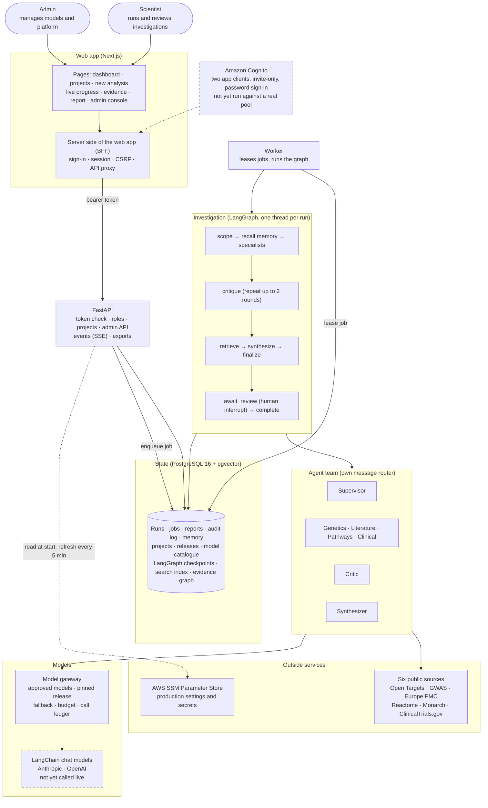
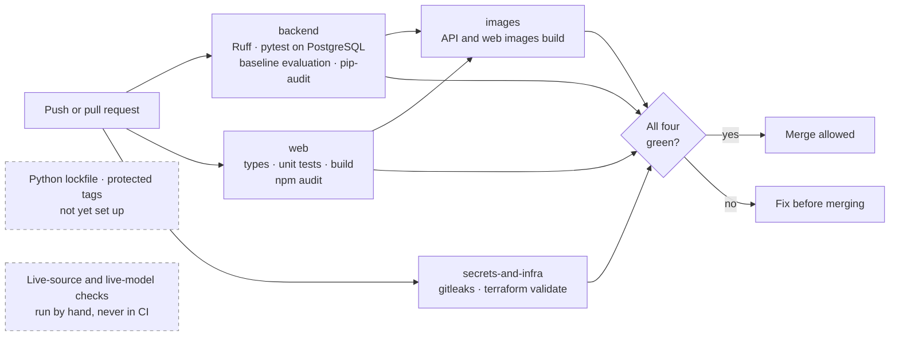
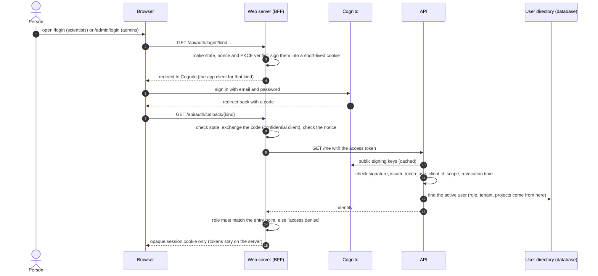
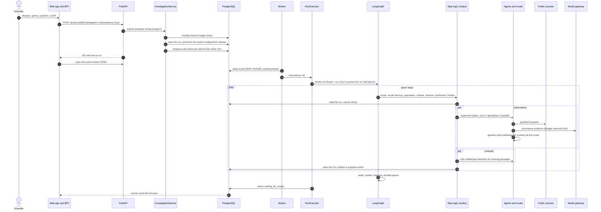
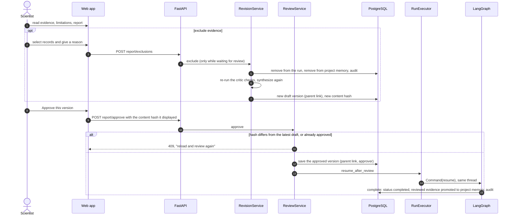
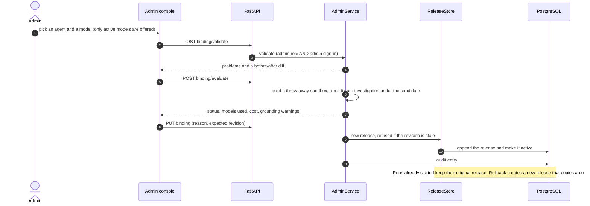

# BioNexus AI

BioNexus is an evidence-review assistant for drug-target research: a scientist names a disease and up to five genes, a team of specialist AI agents gathers evidence from public genetics, literature, pathway and clinical-trial sources, a critic flags conflicts and gaps, and the scientist **reviews, excludes what they distrust, and approves one exact report version**. Every claim cites the evidence behind it, every excluded record is listed with a reason, and the models and data versions used are recorded.

**Status:** backend core implemented and tested (typed contracts, a LangGraph investigation workflow with PostgreSQL checkpoints and a human-review interrupt, seven agents on an allowlisted message router, six live public-source adapters, a model gateway with fallback and budgets, hybrid retrieval, reports in Markdown, Word and JSON, and a baseline evaluation harness). Also a FastAPI layer with role checks, a Cognito token verifier, project spaces and an admin API. Also a Next.js web app: sign-in pages, dashboard, new analysis, live progress, evidence, report and approval screens, and an admin console. Also Terraform, a Docker Compose stack and runbooks for a single Lightsail host. **Not built yet:** a run against a real Cognito pool, any live AI-model call, a real deployment, the pilot and its locked evaluation set, scheduled source refresh, raw-response capture. See [`docs/IMPLEMENTATION_STATUS.md`](docs/IMPLEMENTATION_STATUS.md) for task-by-task status.  
**Design baseline:** October 23, 2026  
**Demo data:** a small **synthetic** Crohn's disease sample is built in and is the default. Real public databases are used when you switch to live mode. Nothing here is a clinical tool.

## Why this exists

Every new medicine starts with a **target**, a gene or protein that plays a part in a disease. Picking the wrong one is a common reason drugs fail in human trials, and clues from people's own genes are one of the best early signs that a target is the right one. Before a team spends lab time, someone has to answer: *how many independent studies really back this gene–disease link?* That answer is scattered across databases and papers, the same study turns up in several places, and a long list of hits looks like proof when it often is not.

In one real run on 24 October 2026 (COVID-19 with ACE2 and TMPRSS2, live public databases, about 20 seconds), BioNexus collected **44 records**. They were **39 distinct studies** once repeats were merged, and only **8 findings** actually pointed to an association (5 for ACE2, 3 for TMPRSS2, none against). The rest was context such as trial registrations and papers that only mention a gene, and nine more papers were set aside because their licence does not allow reuse. These numbers change as the databases change.

BioNexus adds four things a plain literature search or a generic chatbot does not:

1. **Independent studies are counted once.** The same study seen through several databases is one `study_family`.
2. **Direction is explicit.** A finding supports, opposes, or states no direction. Trial registrations and pathway annotations are never counted as support.
3. **Gaps and conflicts are shown, not hidden.** A critic agent flags contradictions and missing passages, and every excluded record is listed with the reason.
4. **A person decides, and the record is reproducible.** A scientist approves an exact report version; the report names the models, skills and data versions behind it.

**Honest test still open.** The offline sample is too small to show that several agents beat a simpler single-agent approach (task EVAL-14). On it, a single-agent baseline scores the same as the full team. A real answer needs a scientist-written locked question set and real models (see "Limits and honest caveats").

## What BioNexus does

- **Investigations:** choose a disease, up to five genes, a question and an evidence cutoff date. The run is durable: it survives a worker restart and resumes at the exact step.
- **Seven agents with one job each:** a supervisor that plans, genetics, literature, pathways and clinical specialists, an evidence critic and a synthesizer. They talk only through a recorded message router with an allowlist, a depth cap and duplicate rejection.
- **Six live sources:** Open Targets, GWAS Catalog (REST v2), Europe PMC, Reactome, Monarch and ClinicalTrials.gov, reached through a guarded HTTP client (host allowlist, HTTPS only, 30 second timeout, bounded retries, 2 MB size cap).
- **Evidence you can check:** an evidence chart (independent studies per gene, by direction), a card per record with its passage, and a source-completeness table. Only evidence that is licensed, dated before your cutoff and backed by a passage can be cited.
- **A human gate:** the run pauses at a durable review step. A scientist can exclude evidence (with a reason, which also removes it from project reuse), regenerate the draft, and approve one version by its content hash.
- **Reports:** Markdown, Word and a JSON manifest with the configuration release, skill hashes, source snapshots and every model call.
- **Project spaces:** a scientist creates a private workspace per disease or study and invites colleagues. Reviewed evidence is reused only inside the project where it was approved.
- **Admin console:** add, deprecate or disable AI models at runtime; change which model each agent uses with validate, fixture evaluation, activate and rollback; usage and cost; source health; skills; an append-only audit log; an emergency stop.
- **Configuration from the right place:** a `.env` file locally, AWS SSM Parameter Store in production. No secret is in the code.
- **Quality gates:** lint with a cyclomatic-complexity limit, tests against in-memory and real PostgreSQL stores, a secret scan, a baseline evaluation, Terraform validation and image builds (defined in GitHub Actions, not yet run on GitHub).
- **Not built:** a run against a real Cognito pool, a live AI-model call, scheduled source refresh, raw-response capture, mapping-correction UI, remove-member and delete-project, the pilot evaluation.

## How this compares with existing products

Several good products already help with parts of this problem. BioNexus does not replace them; it takes a different approach.
The descriptions below come from each product's own public material and were checked in October 2026. Vendor figures are the vendors' claims, not independent measurements, and products change, so confirm before relying on them.

| Product | What it is | Where BioNexus is different |
|---|---|---|
| [Open Targets Platform](https://platform-docs.opentargets.org/associations) | Free public resource that scores target–disease links from genetics, drugs, expression and literature text mining. Its own documentation says the score reflects *how much* evidence exists, not how good it is. | BioNexus uses Open Targets as one of six live sources, then goes a step further: it counts independent study families, shows direction (supports, opposes, unknown) and flags contradictions. It does not produce a single association score. |
| [Causaly](https://www.causaly.com/use-cases/target-identification-prioritization) | Commercial platform with a proprietary biomedical knowledge graph and a target ontology for target identification, showing mechanisms, directional effects and contradictory findings. | Causaly has a much larger, curated knowledge base and a mature product. BioNexus is open to inspect and run yourself, has no proprietary graph, and bases every claim on passages fetched from public sources for that run. |
| [Insilico Medicine PandaOmics](https://www.bio-itworld.com/news/2024/02/27/validated-ai-driven-target-identification-and-biomarker-discovery-with-insilico-medicine-s-pandaomics) | Commercial AI platform that ranks targets using omics, text, commercial and expert scores, with novelty, druggability and safety views. | PandaOmics predicts and ranks targets from omics data, which BioNexus does not do. BioNexus is a review tool: it checks what published evidence says and abstains when the evidence is thin. |
| [Elicit](https://elicit.com/) and similar AI research assistants | General AI tools that search papers, screen them and extract data into tables with citations. | They are built for literature review across any field. BioNexus is built for one question, a gene and a disease, and combines genetics, pathway and clinical-trial sources with papers, not only papers. |
| Searching PubMed and databases by hand | The usual baseline. | Slow and hard to repeat, but fully under the scientist's control. BioNexus automates the gathering and keeps the scientist's sign-off. |

### What BioNexus does differently

- **Independent evidence, not volume.** Records from the same study are grouped into one study family, so "10 papers" that reuse one cohort count once.
- **Every claim traces to a passage.** A claim without a source passage is not allowed into the report.
- **Contradictions are shown, not smoothed over.** Opposing findings and single-study support appear as issues in the report.
- **A rule gate before anything counts.** Evidence must be licensed for use, dated before your cutoff and not excluded in review.
- **A scientist signs off.** A run stops for human review before it is final, and only approved evidence is reused, only inside the same project.
- **Reproducible and auditable.** Each run is pinned to a configuration release (skills, models, settings), and every model call, cost and decision is recorded.
- **Cost controlled.** Hard per-run and per-organisation model budgets, and a single small server (see [`docs/costs.md`](docs/costs.md)).
- **Honest about limits.** It does not claim causation, give treatment advice or hide missing evidence.

### Where existing products are stronger

Be clear about this before choosing:

- **Scale and curation.** Causaly and Open Targets cover far more data than the six public sources used here.
- **Prediction.** PandaOmics and similar tools model omics data to find new targets; BioNexus only reviews published evidence.
- **Maturity.** The commercial products have customers, support and validation. BioNexus has none of that yet: it has never made a live AI-model call, has not been deployed, and has not been shown to beat a simpler single-agent approach on a real evaluation set (see [Limits](#limits-and-honest-caveats)).

## Architecture

Solid boxes are built and tested. Dashed boxes exist in code but have not been run against the real service.



The graph holds only control data (`run_id`, repair round, approval). The investigation itself (`RunState`) is loaded from and saved to PostgreSQL by each step, so the API, UI, audit log and reports all read one source of truth, and a retried step starts from clean state.

**What leaves your machine.** In demo mode nothing does. In live mode the disease and gene names go to the six public APIs. When a real AI model is configured, the question and evidence text (passages shortened to 300 characters inside a delimited data block) go to that model's provider. The offline embedder and the search index stay in your database.

### How an investigation can end

| Outcome | When | Shown to the user as |
| --- | --- | --- |
| `waiting_for_review` | The draft report is built and the graph is paused at the review step | "Needs your review" |
| `completed` | A scientist approved an exact report version | "Approved" |
| `incomplete` | A source was unavailable after two retries, no eligible evidence was found, the model budget or call limit was reached, models were stopped by an admin, or no approved model could answer | "Incomplete: partial results shown, nothing invented" |
| `failed` | An unexpected error | "Failed" with the error class and message |
| `cancelled` | The scientist cancelled; partial results are kept | "Cancelled" |

Incomplete and failed runs keep their LangGraph checkpoint at the failing step. They end honestly, never with an invented finding.

### Quality gate in CI



The workflow is in [`.github/workflows/ci.yml`](.github/workflows/ci.yml). It has not yet been run on GitHub. Anything that calls a paid model or a live public database (`python -m bionexus.sources.smoke`, the live COVID check) is run by hand on purpose.

## Sequence diagrams

These follow the code in `services/api/bionexus/`.

### Sign-in (two entry points, one user pool)



Roles live in the BioNexus database, not in token claims. An administrator signing in through the scientist client, or a scientist through the admin client, is refused by the server, not by hidden menus. Local development replaces Cognito with random dev tokens from your own `.env`, and refuses to start in production.

### Investigation path (scientist starts a run)



### Review and approval



### The journey of one investigation

An investigation turns a question into a **reviewed draft**. The scientist, not the system, decides what is accepted. The whole run is a LangGraph thread keyed by the run id, so it can be resumed after a crash.

1. **The request arrives.** From the web app or the API, after a project-membership check. The request must name 1 to 5 genes (letters, digits and hyphens, 2 to 15 characters), a disease and a question. The run is saved first, pinned to the active configuration release, and a job is enqueued with an idempotency key, so a double click creates one run.
2. **A worker picks it up.** It leases the job (`SKIP LOCKED`, five-minute lease, at most three attempts). If the worker dies, the lease expires and another worker resumes the same thread from its last checkpoint without starting a second investigation.
3. **Scope.** A cheap check that the request is complete.
4. **Recall reviewed memory.** Evidence this project's scientists already **approved**, for the same genes, still licensed and still before the cutoff, is added to the run. Unreviewed work is never reused, and a remembered conclusion is never counted as a new independent finding.
5. **Specialists, in parallel (2 at a time).** The supervisor plans fixed tasks for genetics, literature and clinical. Each specialist queries its own sources, then the **eligibility gate** keeps out anything unlicensed, dated after your cutoff or excluded in review, and records why. Genetics then asks the pathways agent for context, but only for genes with genetic support, through the router. If no eligible evidence exists at all, the run ends as `incomplete: no evidence found`. A transient source failure is retried (two retries); a persistent one ends the run as `incomplete`.
6. **Critique, up to two rounds.** A pure function finds three kinds of issue: a record with no supporting passage, a gene with both supporting and opposing studies, and a gene resting on one study family. For a missing passage from Europe PMC the critic sends a challenge to the literature agent, which fetches the passage or says it cannot. Each challenge is sent once. Issues still open after the last round are listed in the report.
7. **Retrieve and rank.** Accepted evidence is indexed (full text plus vectors) and ranked for your question by fusing the two rankings with Reciprocal Rank Fusion. A small evidence graph is expanded at most two hops and 100 edges, only over approved relation types, with tenant and cutoff filters applied in SQL. Connectivity is context, not evidence of mechanism.
8. **Synthesize.** Claims are written per gene from at most 40 retained, ranked, accepted records, and each claim cites its record ids. A short narrative comes from the configured model. If the narrative contains blocked language (for example "causes", "cures", "should take"), it is replaced by the plain claim list.
9. **Finalize.** The draft report (Markdown) and its manifest are built, hashed, and saved. Saving the draft twice returns the first, so a retried step cannot create a second report.
10. **Pause for review.** The graph interrupts and the status becomes `waiting_for_review`. See the approval diagram for what happens next.

**Example numbers** come from the real COVID-19 run described above: 44 records from five databases, 39 distinct study families, nine more records excluded for licence reasons, and 8 findings pointing to a direction. They illustrate the mechanics. Live results vary.

**Spending is capped before each call.** Every model call reserves its worst-case cost first, then settles to the actual cost. Defaults: US$10 hard limit and US$5 warning per investigation, 40 calls, and a monthly cap per organisation (US$200). All are settings that apply to the next submission.

**Which code does each step**

| Step | Class or function | File |
| --- | --- | --- |
| 1 Request | `submit()` route, `InvestigationService.submit()` | `api/run_routes.py`, `services.py` |
| 2 Worker | `Worker.run_pending()`, `RunExecutor.execute()` | `jobs/worker.py`, `workflow/runner.py` |
| Graph shape | `InvestigationGraph.build()` | `workflow/graph.py` |
| 3 to 4 Scope, memory | `InvestigationNodes.scope()`, `.recall_memory()` | `workflow/nodes.py`, `storage/ports.py` |
| 5 Specialists | `Dispatcher.run_parallel()`, `SpecialistAgent.assess()`, `GeneticsAgent.follow_ups()` | `workflow/dispatcher.py`, `agents/base.py`, `agents/specialists.py` |
| Router | `MessageRouter.accept()` | `messaging/router.py` |
| Eligibility | `partition_eligible()` | `evidence/eligibility.py` |
| Sources | `GuardedHttp`, the six `*Source` classes | `sources/http.py`, `sources/live.py` |
| 6 Critique | `find_issues()`, `CriticAgent.handle()` | `agents/critic.py` |
| 7 Retrieve | `RetrievalService.search()` and `.expand()`, `fuse()` | `retrieval/service.py`, `retrieval/fusion.py` |
| 8 Synthesize | `SynthesizerAgent.write()`, `build_matrix()` | `agents/synthesizer.py`, `evidence/matrix.py` |
| 9 Report | `ReportBuilder.build_draft()` | `reporting/builder.py` |
| 10 Review | `await_review` node, `ReviewService.approve()`, `RevisionService` | `workflow/graph.py`, `reporting/review.py`, `reporting/revision.py` |
| Models | `ModelGateway.complete()`, `LangChainClient` | `llm/gateway.py`, `llm/langchain_client.py` |
| Budget | `Budget.reserve()` and `.settle()` | `workflow/budget.py` |

**What the checks do not cover.** The critic and the eligibility gate catch missing support, duplication, licence and date problems, and flagged contradictions. They do not read the science. A stance that comes from a model (for literature) is labelled "extracted by model (unreviewed)", and the direction of a finding can still be wrong. Counting independent studies reduces repetition, but does not make evidence strong. Only a scientist's review does that.

### Admin: change which model an agent uses



## Technology stack

| Layer | Choice |
| --- | --- |
| API and worker | Python 3.12, FastAPI, Pydantic, psycopg 3, `uvicorn` |
| Investigation flow | **LangGraph** (graph, bounded repair loop, retry policy, PostgreSQL checkpoints, human-review interrupt). The investigation data itself is not stored in the graph |
| Model access | **LangChain** chat models (`ChatAnthropic`, `ChatOpenAI`) behind our own `ModelClient` port. No LangChain agents, chains, tools, retrievers, memory or tracing ([ADR 1](docs/adr/0001-langgraph-and-langchain.md)) |
| Agent messaging | Our own typed envelope and allowlisted router (not the external Agent2Agent standard) |
| Data sources | Open Targets (GraphQL), GWAS Catalog (REST v2), Europe PMC, Reactome, Monarch (v3), ClinicalTrials.gov (v2). These are **BioNexus adapters**, not official MCP servers |
| Search | PostgreSQL full-text search plus pgvector, fused with Reciprocal Rank Fusion. Offline hashing embedder by default; an OpenAI embedder via LangChain is written and untested live |
| Database | PostgreSQL 16 with pgvector; an in-memory store for tests and the offline demo. Forward-only SQL migrations (`storage/migrations/`) |
| Auth | Amazon Cognito (two app clients, invite-only, password sign-in; no MFA yet), JWT verification with generated-key tests; roles and projects live in the database |
| Configuration | `.env` locally, **AWS SSM Parameter Store** in production, models editable at runtime |
| Frontend | Next.js 16, React 19, TypeScript, plain CSS design system with light and dark themes |
| Reports | Markdown, Word (`python-docx`), JSON manifest |
| Infrastructure | Terraform (Lightsail, Cognito, SSM parameters, budget alert), Docker Compose with a Caddy TLS proxy, one Lightsail host. Nothing is applied to a real AWS account |
| Quality tooling | Ruff (including a McCabe complexity limit), pytest and `moto` (mock AWS), Vitest, `radon`, Bandit, gitleaks, pip-audit, npm audit |

## Repository structure

```text
week3/
  services/api/
    bionexus/
      contracts/       typed data models: evidence, messages, projects, lifecycle, errors
      auth/            Cognito token verifier, authorization rules
      llm/             model catalogue, configuration releases, gateway, LangChain clients
      sources/         guarded HTTP, six live adapters, offline fixtures (synthetic)
      evidence/        eligibility gate (licence, cutoff), study-family matrix
      agents/          supervisor, four specialists, critic, synthesizer, skill registry
      messaging/       message envelope builder and router
      workflow/        LangGraph graph, step logic, dispatcher, budget, executor, events
      memory/, retrieval/   reviewed project memory; full-text + vector search and evidence graph
      reporting/       builder, review, revision, Word export, next experiments
      jobs/            job leasing worker
      storage/         ports, in-memory and PostgreSQL stores, migrations
      api/             routes (runs, projects, admin), dependencies
      evals/           baselines, ablations and metrics (synthetic reference set)
      container.py     the one place that wires everything together
      params.py        .env / SSM configuration source
    tests/             193 tests; most run against both stores
  apps/web/            Next.js app: pages, components, sign-in (BFF), tests
  skills/              versioned, hashed agent instructions (one per agent)
  config/              example model seed list (prices must be verified before use)
  infra/terraform/     Lightsail, Cognito, SSM parameters, budget
  infra/lightsail/     Docker Compose stack and Caddy proxy
  scripts/             init-env, ci-deploy (ship a release), deploy with rollback, encrypted backup, restore, host patching
  docs/                implementation status, configuration, ADR, runbooks
  .github/workflows/   ci.yml
  todo.md              the full implementation plan and its task ids
```

## Start here

1. [`docs/IMPLEMENTATION_STATUS.md`](docs/IMPLEMENTATION_STATUS.md): what is built, how it was verified, and what is not.
2. [`docs/configuration.md`](docs/configuration.md): every setting, where it comes from (`.env` or SSM), and what applies without a restart.
3. [`docs/adr/0001-langgraph-and-langchain.md`](docs/adr/0001-langgraph-and-langchain.md): exactly where LangGraph and LangChain are used, and where they are not.
4. [`docs/runbooks/`](docs/runbooks/README.md): users and roles, deploy and rollback, restore, secrets, incidents.
5. [`todo.md`](todo.md): the 21-phase plan with task ids (`AUTH-09`, `MODEL-11`, …) that code and docs refer to.
6. [`infra/terraform/`](infra/terraform) and [`infra/lightsail/`](infra/lightsail): the deployment definition.

## Run it locally

No API keys, Docker or cloud account are needed for the demo: it runs on synthetic data, a placeholder AI model and an in-memory store.

### 1. Install the prerequisites

- **Python 3.12 or newer** and **Node 22 or newer**. Docker is optional (only for the PostgreSQL tests and the images).

### 2. Install dependencies and create your local settings

```bash
python3 -m venv .venv && .venv/bin/pip install -e "services/api[dev]"
scripts/init-env.sh             # writes .env with random local values (gitignored, mode 600)
```

### 3. Check that everything works

```bash
cd services/api
../../.venv/bin/ruff check .                  # lint, including the complexity limit
../../.venv/bin/python -m pytest              # unit and API tests
../../.venv/bin/python -m bionexus.demo       # a full investigation, prints the draft report
../../.venv/bin/python -m bionexus.evals.run  # baselines vs the agent team vs an ablation
```

The PostgreSQL test cases need a database. `scripts/init-env.sh` writes `BIONEXUS_TEST_DSN` into `.env` along with the exact `docker run` line for a throwaway database. Without it those cases skip and the in-memory ones still run.

### 4. Run the web app

```bash
# terminal 1: the API (dev sign-in tokens come from your .env)
cd services/api && ../../.venv/bin/uvicorn bionexus.api.main:app --port 8100

# terminal 2: the web app
cd apps/web && npm install
BIONEXUS_API_URL=http://localhost:8100 PUBLIC_BASE_URL=http://localhost:3100 npm run dev -- -p 3100
```

Open `http://localhost:3100`. **Scientist sign-in** and **Admin sign-in** each sign you in as a built-in dev user. Try **New analysis**, pick the Crohn's example, and follow the progress, evidence, agent team, report and approval screens. Then sign in as an administrator to see the agent matrix, model registry, usage and audit history. Everything is held in memory, so restarting the API clears all runs.

Checks (from `apps/web`): `npm run typecheck`, `npm test`, `npm run build`.

### Analyse any disease with live public data

The offline default only knows the synthetic Crohn's sample, and the New analysis page says so. To query the real databases, set `BIONEXUS_SOURCES=live` in `.env` and restart the API, then choose the COVID-19 example or type any disease and up to five genes. A run takes about a minute.

```bash
cd services/api && ../../.venv/bin/python -m bionexus.sources.smoke    # one real request to each source
```

### Use a real AI model (optional)

Literature papers have no stated direction until a real model classifies them, and the narrative uses the configured model. Put a provider key in `.env` (never in a committed file) and register a model with **verified** prices:

```bash
ANTHROPIC_API_KEY=<your key>           # or OPENAI_API_KEY
# then in the admin console: Model registry → Add model (provider, model id, key name, prices, price date)
```

A new model must pass a capped smoke test before it can be bound to an agent. Prices in `config/models.example.json` are placeholders on purpose; loading a model without a verified price is refused. See [`docs/configuration.md`](docs/configuration.md).

### Use PostgreSQL instead of the in-memory store

The production container (`bionexus.bootstrap.production_container`) uses PostgreSQL and runs migrations at start. Locally, run the test database from the previous step and point `BIONEXUS_DATABASE_URL` at it with `APP_ENV=production` plus the Cognito settings, or just run the test suite, which exercises both stores.

### Run in Docker

```bash
docker build -f services/api/Dockerfile -t bionexus-api:local .
docker build -t bionexus-web:local apps/web
docker run --rm bionexus-api:local python -m bionexus.demo      # a full run inside the image
```

Releases deploy from GitHub Actions on a version tag, after CI passes and a reviewer approves ([`deploy.yml`](.github/workflows/deploy.yml)). The Compose stack in `infra/lightsail/` is for the production host: its containers read every setting from AWS SSM using one bootstrap credential. See [`docs/configuration.md`](docs/configuration.md) and [`docs/runbooks/deploy.md`](docs/runbooks/deploy.md). The Terraform can be checked offline with `terraform init -backend=false && terraform validate`.

### Troubleshooting

| Problem | Fix |
| --- | --- |
| Port 3000 is in use | Run the web app on another port, as in step 4 (3100 above), and set `PUBLIC_BASE_URL` to match |
| The PostgreSQL tests are skipped | Start the throwaway database from the `docker run` line in `.env` and rerun |
| Any disease except Crohn's finishes `incomplete: no evidence found` | You are in demo mode. Set `BIONEXUS_SOURCES=live` and restart the API |
| Literature findings show "no stated direction" | No real model is configured yet; add one (above) |
| `Missing required parameter …` at start | In production mode a setting is absent from SSM; the message names it |
| Sign-in goes to "access denied" | The role does not match the entry point (admins use `/admin/login`, scientists use `/login`) |
| A project's name does not show up after creating it | Reload the page; the project list is read fresh from the API |

## Limits and honest caveats

- **Synthetic evidence for the demo.** The offline sample and the reference set used by the evaluation harness are made up. They show the mechanics work, not how accurate the system is on real research.
- **Not deployed, and not run against real accounts.** Nothing has run on a real server, against a real Cognito pool, or with a live AI model. The Cognito verifier and the SSM loader are tested with generated keys and a mock AWS (`moto`). The Compose stack came up healthy locally, but real pricing, quotas and the real AWS credential path are unverified.
- **The multi-agent design is not yet shown to beat a simpler one.** On the tiny offline set a single-agent baseline matches the team. Answering that needs a scientist-written locked evaluation set and real models, and the success targets in the plan (for example 100% of claims linked to evidence, at least 95% expert-confirmed citations, 90% essential-evidence recall) are targets, not results.
- **Direction can be wrong.** Literature direction comes from a model reading an abstract and is labelled unreviewed. Open Targets and GWAS entries are database associations, not proof. Only a scientist's review makes a finding reliable.
- **Source rights are conservative defaults, not legal advice.** For example only open-access Europe PMC articles are reusable. Item-level rights still need a human decision. Records from sources without a date are treated as first seen today.
- **Data leaves the machine in live mode.** Gene and disease names go to six public APIs, and with a real model the evidence text goes to that provider. Do not load confidential material until the provider and retention decisions are made.
- **Single host, no high availability.** The plan is one Lightsail host. The web session store is in memory, so a restart signs everyone out. Do not advertise an enterprise availability promise.
- **Missing features.** Remove-member, rename and delete for projects, mapping corrections, scheduled source refresh, raw-response capture, a Python lockfile, a formal accessibility audit and alert delivery are not built.
- **No treatment advice.** BioNexus assesses public evidence for research use. It does not diagnose, recommend treatment for a person, accept patient records, or establish that a gene causes a disease. Counts and scores guide judgement and are not probabilities.

## Security

See [`SECURITY.md`](SECURITY.md) for how to report a problem, what is kept out of the repository, and the checks that run on every change.

## License

Apache License 2.0, see [`LICENSE`](LICENSE). Check the terms of the public data sources you enable; they are separate from this licence.
