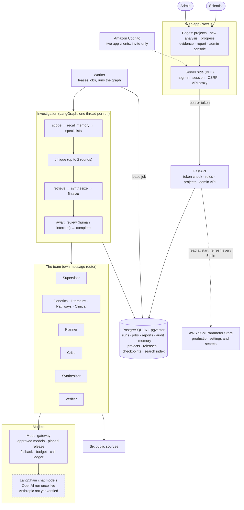
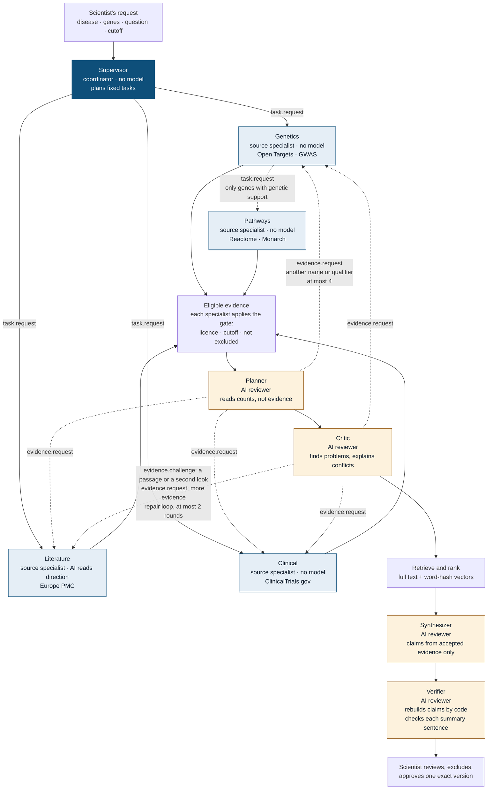

# BioNexus AI

[](https://github.com/Tevaalgorithms/BioNexus-AI/actions/workflows/ci.yml)

BioNexus is an evidence-review assistant for drug-target research. A scientist names a disease and up to five genes. A team of source specialists gathers evidence from public genetics, literature, pathway and clinical-trial sources, and AI reviewers plan further searches, flag and explain conflicts, check the findings and write the draft. The scientist **reviews, excludes what they distrust, and approves one exact report version**. Every claim cites the evidence behind it, every excluded record is listed with a reason, and the models and data versions used are recorded.

**Product:** [bionexus.tevaalgorithms.com](https://bionexus.tevaalgorithms.com). Sign-in is invite-only.

**Status: MVP**, running on one AWS Lightsail host. Demo data is a small synthetic Crohn's disease sample; live mode uses six public databases. Research use only: it does not recommend treatment or claim that a gene causes a disease. What is not done yet, and what is not proven, is in [`docs/limits.md`](docs/limits.md).

## Why this exists

Every new medicine starts with a **target**, a gene or protein involved in a disease. Picking the wrong one is a common reason drugs fail in human trials. Before lab time is spent, someone has to answer: *how many independent studies really back this gene-disease link?* The answer is scattered across databases and papers, the same study appears in several places, and a long list of hits looks like proof when it often is not.

BioNexus adds four things a plain search or a chatbot does not:

1. **Independent studies are counted once.** One `study_family`, however many databases show it.
2. **Direction is explicit.** A finding supports, opposes or states none. Trial registrations and pathway annotations never count as support.
3. **Gaps and conflicts are shown,** and every excluded record is listed with its reason.
4. **A person decides, and it is reproducible.** A scientist approves one exact version, and the report names the models, skills and data versions behind it.

In one live run (24 October 2026, COVID-19 with ACE2 and TMPRSS2, about 20 seconds), 44 records were 39 distinct studies, and only 8 findings pointed to an association. Numbers change as the databases change.

## What it does

- **Durable investigations:** they survive a worker restart and resume at the exact step.
- **Nine roles, one job each** (see [the roles](#the-roles)). They talk only through a recorded, allowlisted message router.
- **Six live sources:** Open Targets, GWAS Catalog, Europe PMC, Reactome, Monarch and ClinicalTrials.gov, through a guarded HTTP client (host allowlist, HTTPS only, timeouts, size cap). These are BioNexus adapters, not MCP servers.
- **Evidence you can check:** only licensed, pre-cutoff evidence backed by a passage can be cited.
- **A human gate:** exclude evidence, regenerate the draft, approve one version by its content hash.
- **Reports** in Markdown, Word and a JSON manifest (release, skill hashes, every model call).
- **Project spaces:** a private workspace per disease or study. Reviewed evidence is reused only inside it.
- **Admin console:** invite users by email, manage models and per-role bindings, usage and cost, source health, audit log, emergency stop.
- **Spending caps** per run and per organisation, reserved before each call.
- **Configuration:** a git-ignored `.env` locally, AWS SSM in production. No secret is in the code.

## Architecture

Solid boxes are built and tested. Dashed boxes exist in code but have not been verified against the live service.



**LangGraph and LangChain, used narrowly.** LangGraph runs the investigation: graph shape, bounded repair loop, retries, PostgreSQL checkpoints and the review interrupt. It holds only control data; the investigation lives in your own tables. LangChain supplies only provider-neutral chat models behind our own `ModelClient` port, with budgets, fallback and the call ledger around it in the gateway. No LangChain agents, chains, tools, retrievers or memory.

**What leaves your machine.** Demo mode: nothing. Live mode: disease and gene names go to the six public APIs. With a real model configured, the question and evidence text (passages cut to 300 characters; a second look up to 1,500) go to that model's provider.

Sequence diagrams and a step-to-code map: [`docs/architecture.md`](docs/architecture.md).

## The team and how it talks

### The roles

Nine roles, each with one job: a coordinator, four source specialists and four AI reviewers. Five call an AI model; four are plain code. Who does what, and what each uses a model for: [`docs/architecture.md`](docs/architecture.md#the-roles-in-detail).

**Which model?** An admin binds each model-using role to a model in **Team & models**, and every change is validated and saved as a new release. Locally the models are placeholders, so the demo needs no key. Each role's instructions are a versioned, hashed file in `skills/`.

**Model text is untrusted.** A bad reply counts as no answer, causal or treatment wording is dropped, and if no model is available the step is skipped and the report says what was not checked.

### The flow

Nodes are coloured by kind: dark is the coordinator, light blue a source specialist, amber an AI reviewer. A dashed edge is a request one role makes of another; a solid edge moves the run on.



**Who acts at each step**

| Step | Who | Uses a model? |
| --- | --- | --- |
| 1 Check request | The workflow | No |
| 2 Recall reviewed work | The workflow (this project's approved evidence) | No |
| 3 Gather evidence | Supervisor starts genetics, literature and clinical; genetics may ask pathways | Literature, only to read the direction of papers that state none |
| 4 Review coverage | Planner, then the specialists it asks | Planner |
| 5 Challenge and repair | Critic, literature and any specialist the critic asks | Critic; literature for second looks and new papers |
| 6 Rank and connect | The workflow (search index and evidence graph) | No |
| 7 Write findings | Synthesizer | Synthesizer |
| 8 Verify findings | Verifier | Verifier, for summary sentences |
| 9 Build report | The workflow | No |
| 10 Review and approval | The scientist | A person decides |

Up to two specialists run at the same time. The workflow calls the synthesizer directly after ranking. The supervisor starts the planner, the critic and the verifier by sending each a task at its step, so those handoffs are recorded like any other.

### Communication between team members

Roles never call each other directly. A role returns messages, and the dispatcher hands each one to a **router** that checks it before delivery: who may message whom, replies only to what was asked, at most 3 handoffs deep and 60 messages per run, and duplicates dropped. Every accepted message is recorded with the run and shown in the activity feed. This is BioNexus's own internal protocol, not the external Agent2Agent standard. The sequence diagram, the message envelope, what a request may carry and the full rules: [`docs/agent-communication.md`](docs/agent-communication.md).

## How a role is built: LangGraph and LangChain

The roles are **not** LangChain agents. They are small classes of our own. LangGraph decides *when* a role runs, and LangChain is only the last step that talks to a model provider. The planner is the example below because it is short and uses a model. Every path in this section is under `services/api/bionexus/`.

```text
LangGraph node  ->  Dispatcher  ->  Planner.handle()  ->  Gateway  ->  LangChain chat model  ->  provider
 (when it runs)     (our router)     (what it does)      (our rules)    (the one LangChain use)
```

The full walkthrough, with the code for each of seven steps (instructions, the role class, the model call, registration, its place in the graph, how a message reaches the role, and run, pause and resume) and the whole path in order, is in [`docs/how-a-role-is-built.md`](docs/how-a-role-is-built.md).

### Why these two, and why only these parts

| | Used for | Deliberately not used for |
| --- | --- | --- |
| **LangGraph** | The explicit graph shape. The bounded repair loop (a conditional edge, at most 2 rounds). Retries of transient source failures. Durable checkpoints, so a restart resumes at the exact step. The human-review `interrupt`. | The investigation's data, which lives in our own tables so the API, UI and audit log read one source of truth. Routing between roles (our router). Memory (our scoped stores). |
| **LangChain** | One maintained, provider-neutral chat-model interface (`ChatAnthropic`, `ChatOpenAI`) with usage metadata and transport retries. | Agents, chains, tools, retrievers, memory and vector stores. A role's powers must be bounded and checkable: the planner can only ask for searches, and every message passes an allowlisted router. A general agent loop would hide that. |

Writing the roles ourselves keeps each one small and testable with a scripted model, and the product's rules (budgets, approved models, fallback, the ledger) in one place, whichever library or provider sits underneath.

## Agent optimizations

How an investigation stays cheap and fast. Every lever is a named constant in [`agents/optimization.py`](services/api/bionexus/agents/optimization.py), so they can be read, tuned and reviewed together. The labels (AO-1 to AO-10) match the code comments and the tests in [`tests/test_agent_optimization.py`](services/api/tests/test_agent_optimization.py).

| # | What we did | Where |
| --- | --- | --- |
| **AO-1** | **Only roles that need judgement call a model.** The supervisor, genetics, pathways and clinical are plain code; their summary calls, which nothing read, were removed. | `specialists/`, `agents/base.py` |
| **AO-2** | **Small prompts.** Passages are cut to 300 characters. A second look reads up to 1,500, on at most 3 records per round. Replies are capped at 400 tokens. | `agents/optimization.py`, `llm/models.py` |
| **AO-3** | **A cap on direction reading:** at most 10 papers per run. | `agents/literature.py` |
| **AO-4** | **A cap on synthesis:** at most 40 accepted records. | `agents/synthesizer.py` |
| **AO-5** | **A response cache.** An identical prompt from the same organisation is answered from memory at no cost. | `llm/cache.py`, `llm/gateway.py` |
| **AO-6** | **Two specialists run at the same time.** | `workflow/dispatcher.py` |
| **AO-7** | **Direction calls run four at a time,** results kept in order. | `agents/literature.py` |
| **AO-8** | **The planner reads counts, not evidence.** At most 4 extra searches, once per run; a request is answered by a search, not a model call. | `agents/planner.py` |
| **AO-9** | **Each conflict is explained once:** at most 4 records per side, 3 conflicts per round. | `agents/critic.py`, `agents/conflict.py` |
| **AO-10** | **The verifier checks claims with plain code.** A sentence that is a claim word for word needs no model call; at most 8 others are checked. | `agents/verifier.py` |

Safety limits sit beside these: a budget is reserved before every model call, per run and per organisation, and the router caps messages and handoff depth ([`budget.py`](services/api/bionexus/workflow/budget.py), [`router.py`](services/api/bionexus/messaging/router.py)).

### The levers

```python
# services/api/bionexus/agents/optimization.py
AO_PASSAGE_CHARS = 300             # AO-2: how much of a passage a normal prompt carries
AO_RECHECK_PASSAGE_CHARS = 1500    # AO-2: a second look reads the whole retrieved passage
AO_MAX_RECHECKS_PER_ROUND = 3      # AO-2: second looks per repair round (each is one model call)
AO_MAX_DIRECTION_CALLS = 10        # AO-3: papers whose direction a model reads
AO_MAX_RETAINED_EVIDENCE = 40      # AO-4: records the synthesizer may use
AO_RESPONSE_CACHE_ENTRIES = 512    # AO-5: answers remembered per process (0 turns the cache off)
AO_MAX_PARALLEL_SPECIALISTS = 2    # AO-6: specialists running at once
AO_MAX_PARALLEL_MODEL_CALLS = 4    # AO-7: direction calls running at once
AO_MAX_PLANNER_REQUESTS = 4        # AO-8: extra searches the planner may ask for, once per run
AO_MAX_CONFLICT_ANALYSES = 3       # AO-9: conflicts the critic explains per round (one call each)
AO_MAX_CONFLICT_RECORDS = 4        # AO-9: records shown to the model per side of a conflict
AO_MAX_VERIFIED_SENTENCES = 8      # AO-10: summary sentences the verifier checks with a model
```

### AO-7: direction calls run together

Each paper's direction is an independent question, and `pool.map` returns results in the original order, so the evidence list is unchanged.

```python
# services/api/bionexus/agents/literature.py
def _with_stances(self, records: list[EvidenceRecord], state: RunState) -> list[EvidenceRecord]:
    """AO-7: the direction calls are independent, so they run together; order is kept."""
    with ThreadPoolExecutor(max_workers=AO_MAX_PARALLEL_MODEL_CALLS) as pool:
        return list(pool.map(lambda record: self._with_stance(record, state), records))
```

### AO-5: an identical prompt is paid for once

The gateway checks the cache before it calls a model. A hit is recorded in the call ledger as `cached`, with zero tokens and zero cost, so the report's list of model calls stays honest.

```python
# services/api/bionexus/llm/gateway.py  (ModelGateway.complete)
key = self._cache.key(state.tenant_id, binding, prompt)
cached = self._cache.get(key)
if cached is not None:
    self._record_hit(state, agent, cached)   # cost 0, no call used, flagged cached=True
    return cached.text
answer = self._ask_chain(state, agent, binding, prompt)
self._cache.put(key, answer)
return answer.text
```

The key covers the organisation, the model and fallback, the output cap, the temperature and a hash of the prompt. So one organisation never receives another's answer, a changed model setup never reuses an old one, and the prompt itself is never stored. The cache is a bounded in-memory LRU, emptied on every restart.

**Provider-side prompt caching is not claimed.** Our prompts put the fixed text first, which suits a provider's cache, but they are far below the roughly 1,000-token minimum, so no saving is assumed.

**Not done yet:** the cache is per process; public source responses are not cached between runs; second looks run one at a time and each paper is read in its own call (batching changes the prompt and needs an evaluation first); and there is no speed benchmark, only tests that the calls overlap and keep their order.

## Technology

| Layer | Choice |
| --- | --- |
| Backend | Python 3.12, FastAPI, Pydantic, psycopg 3 |
| Workflow and models | LangGraph (graph, checkpoints, human review), LangChain chat models behind our own port |
| Data and search | PostgreSQL 16 with pgvector. Full-text search plus vector search, fused with Reciprocal Rank Fusion. The vectors are word-count hashes, not semantic embeddings yet (see [limits](docs/limits.md)). An in-memory store serves tests and the offline demo |
| Auth | Amazon Cognito (invite-only, password sign-in, no MFA yet); roles and projects live in the database |
| Frontend | Next.js 16, React 19, TypeScript, plain CSS with light and dark themes |
| Infrastructure | Terraform, Docker Compose with a Caddy TLS proxy, one Lightsail host |
| Release | GitHub Actions: checks, build images to ECR, deploy over AWS SSM with GitHub OIDC (no SSH key, no stored AWS keys) |
| Quality | Ruff with a complexity limit of 5, pytest (365 tests in 25 files, most run against both stores), Vitest, Bandit, pip-audit, npm audit, gitleaks, `terraform validate` |

## Repository structure

```text
services/api/   Python backend: contracts, agents/ (roles that call a model), specialists/ (plain-code
                source specialists), workflow/ (LangGraph, supervisor, dispatcher), llm/ (gateway), sources/, storage/
apps/web/       Next.js app: pages, components grouped by feature, hooks, lib
skills/         versioned, hashed instructions, one per role
infra/          Terraform (Lightsail, Cognito, SSM, ECR, deploy role) and the Docker Compose stack
scripts/        init-env, install-hooks, deploy with rollback, backup, restore
docs/           architecture, configuration, costs, limits, runbooks
```

Every folder, one line each: [`docs/repository-structure.md`](docs/repository-structure.md).

## Run it locally

The demo needs no API keys, Docker or cloud account. It runs on synthetic data, a placeholder AI model and an in-memory store. You need **Python 3.12+** and **Node 22+**.

```bash
python3 -m venv .venv && .venv/bin/pip install -e "services/api[dev]"
scripts/init-env.sh        # writes a git-ignored .env with random local values
scripts/install-hooks.sh   # optional: blocks commits that contain secrets

# check everything
cd services/api
../../.venv/bin/ruff check . && ../../.venv/bin/python -m pytest
../../.venv/bin/python -m bionexus.cli.demo   # a full investigation, prints the draft report
```

About 100 test cases need PostgreSQL and are skipped when none is running, so expect `265 passed, 100 skipped`. To run them too, start the throwaway database from the `docker run` line in your `.env` (`scripts/init-env.sh` writes it next to `BIONEXUS_TEST_DSN`).

**Run the web app** in two terminals:

```bash
# 1: the API (dev sign-in tokens come from your .env)
cd services/api && ../../.venv/bin/uvicorn bionexus.api.main:app --port 8100
# 2: the web app
cd apps/web && npm ci
BIONEXUS_API_URL=http://localhost:8100 PUBLIC_BASE_URL=http://localhost:3100 npm run dev -- -p 3100
```

Open `http://localhost:3100`. **Scientist sign-in** and **Admin sign-in** each use a built-in dev user. Everything is in memory, so restarting the API clears all runs.

**Live public data.** The offline default knows only the synthetic Crohn's sample. Set `BIONEXUS_SOURCES=live` in `.env` and restart the API to query the real databases for any disease and up to five genes. A run takes about a minute.

**A real AI model (optional).** Put a provider key in `.env` (never in a committed file), then use the admin console: **Model registry, Add model**. Give the provider, model id, key name, prices and the date you verified them. A model without a verified price is refused, and a new model must pass a capped smoke test first. Prices in `config/models.example.json` are placeholders on purpose. See [`docs/configuration.md`](docs/configuration.md).

**See what each review step changes.** With a real model, run the same question with the planner, the critic and the verifier each switched off, and compare what was found, requested, explained and withheld, and what it cost. It shows behaviour, not accuracy; accuracy needs a scientist-written question set.

```bash
cd services/api
../../.venv/bin/python -m bionexus.evals.ablation --disease "Crohn's disease" --genes NOD2,IL23R --live \
    --provider openai --model gpt-4o-mini --input-price 0.15 --output-price 0.60 --price-date 2026-10-24
```

Use prices you have checked. The key is read by name from your `.env`, never from the command line.

## Deploy

Pushing a tag like `v0.1.0` runs the checks, builds the API and web images, pushes them to ECR and deploys to the Lightsail host through AWS Systems Manager, then checks the public URL. A failed health check rolls back to the previous release. The monthly cost is about US$12 to 16 for AWS, with model charges separate ([`docs/costs.md`](docs/costs.md)). Steps and rollback are in [`docs/runbooks/deploy.md`](docs/runbooks/deploy.md). Every setting, and where it comes from, is in [`docs/configuration.md`](docs/configuration.md).

## How this compares with existing products

Several good products help with parts of this problem. BioNexus does not replace them. The descriptions come from each product's public material, checked in October 2026. Vendor figures are the vendors' claims, so confirm before relying on them.

| Product | What it is | Where BioNexus is different |
|---|---|---|
| [Open Targets Platform](https://platform-docs.opentargets.org/associations) | Free public resource that scores target-disease links. Its own documentation calls the score a heuristic based on data availability and says not to read it as a confidence score. | BioNexus uses it as one source, then counts independent study families, shows direction and flags contradictions. It produces no single score. |
| [Causaly](https://www.causaly.com/use-cases/target-identification-prioritization) | Commercial agentic platform that reads literature and a proprietary biomedical knowledge graph, aimed at early target decisions. | Causaly has a far larger curated knowledge base. BioNexus builds every claim from passages fetched from public sources for that run, and records the instructions, models and data versions used, on infrastructure you control. |
| [Insilico PandaOmics](https://www.bio-itworld.com/news/2024/02/27/validated-ai-driven-target-identification-and-biomarker-discovery-with-insilico-medicine-s-pandaomics) | Commercial AI platform that ranks targets from omics, text and expert scores. | PandaOmics predicts targets from omics data, which BioNexus does not. BioNexus reviews published evidence and abstains when it is thin. |
| [Elicit](https://elicit.com/) and similar | General AI research assistant: searches papers, extracts data into tables, runs systematic-review workflows, and offers a research agent and an MCP server. | Built for research in any field. BioNexus is narrow: one gene and disease question, across genetics, pathways and trials as well as papers, with studies counted once and direction explicit. |
| Searching by hand | The usual baseline. | Slow and hard to repeat, but fully under the scientist's control. BioNexus automates the gathering and keeps the sign-off. |

**What is distinct.** No single feature here is unique. The combination is the point: independent studies counted once, direction stated for every finding, unsupported statements withheld, and a scientist approving one exact version with a full record behind it. Whether that leads to better decisions than the products above has not been measured.

**Where existing products are stronger:** scale and curation (they cover far more data than six public sources), prediction (BioNexus only reviews evidence), and maturity (they have customers, support and validation; BioNexus has not yet been shown to beat a simpler single-agent approach on a real evaluation set).

## Documentation

[`docs/architecture.md`](docs/architecture.md) · [`docs/configuration.md`](docs/configuration.md) · [`docs/how-a-role-is-built.md`](docs/how-a-role-is-built.md) · [`docs/costs.md`](docs/costs.md) · [`docs/limits.md`](docs/limits.md) · [`docs/agent-communication.md`](docs/agent-communication.md) · [`docs/repository-structure.md`](docs/repository-structure.md) · [`docs/runbooks/`](docs/runbooks/README.md) (users, deploy, restore, secrets, incidents) · [`services/api/README.md`](services/api/README.md) · [`apps/web/README.md`](apps/web/README.md) · [`CONTRIBUTING.md`](CONTRIBUTING.md) · [`SECURITY.md`](SECURITY.md)

## License

Apache License 2.0, see [`LICENSE`](LICENSE). Check the terms of the public data sources you enable; they are separate from this licence.
