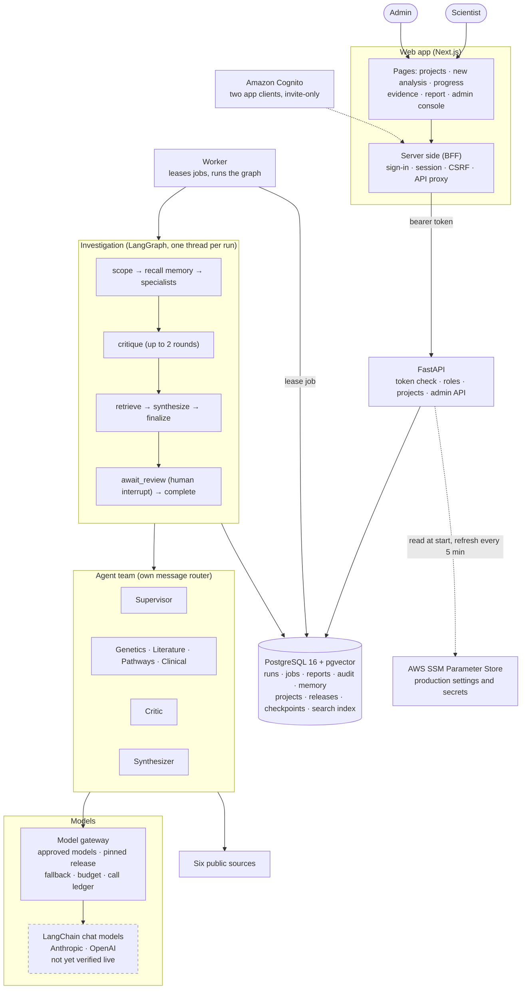
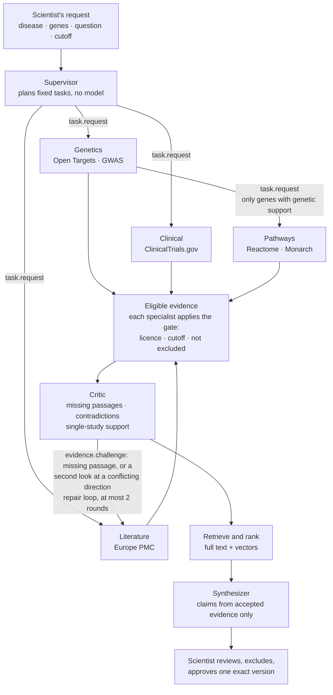
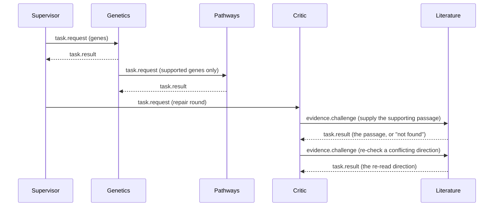

# BioNexus AI

[](https://github.com/Tevaalgorithms/BioNexus-AI/actions/workflows/ci.yml)

BioNexus is an evidence-review assistant for drug-target research. A scientist names a disease and up to five genes. A team of specialist AI agents gathers evidence from public genetics, literature, pathway and clinical-trial sources, and a critic flags conflicts and gaps. The scientist **reviews, excludes what they distrust, and approves one exact report version**. Every claim cites the evidence behind it, every excluded record is listed with a reason, and the models and data versions used are recorded.

**Status: MVP.** It runs on one AWS Lightsail host with invite-only Cognito sign-in, and CI runs on every push. **Not done yet:** a verified live AI-model run end to end, the pilot with a locked evaluation set, scheduled source refresh, raw-response capture, MFA.
**Demo data:** a small **synthetic** Crohn's disease sample is built in and is the default. Real public databases are used in live mode. Nothing here is a clinical tool.

## Why this exists

Every new medicine starts with a **target**, a gene or protein that plays a part in a disease. Picking the wrong one is a common reason drugs fail in human trials, and clues from people's own genes are one of the best early signs that a target is right. Before a team spends lab time, someone has to answer: *how many independent studies really back this gene-disease link?* That answer is scattered across databases and papers, the same study turns up in several places, and a long list of hits looks like proof when it often is not.

BioNexus adds four things a plain literature search or a generic chatbot does not:

1. **Independent studies are counted once.** The same study seen through several databases is one `study_family`.
2. **Direction is explicit.** A finding supports, opposes, or states no direction. Trial registrations and pathway annotations never count as support.
3. **Gaps and conflicts are shown.** A critic flags contradictions and missing passages, and every excluded record is listed with its reason.
4. **A person decides, and the record is reproducible.** A scientist approves an exact report version, and the report names the models, skills and data versions behind it.

In one live run (24 October 2026, COVID-19 with ACE2 and TMPRSS2, about 20 seconds), 44 records came back. They were 39 distinct studies once repeats were merged, and only 8 findings pointed to an association. The rest was context such as trial registrations. Numbers change as the databases change.

## What it does

- **Investigations** are durable: they survive a worker restart and resume at the exact step.
- **Seven agents, one job each:** a supervisor that plans, genetics, literature, pathways and clinical specialists, a critic and a synthesizer. They talk only through a recorded, allowlisted message router.
- **Six live sources:** Open Targets, GWAS Catalog, Europe PMC, Reactome, Monarch and ClinicalTrials.gov, reached through a guarded HTTP client (host allowlist, HTTPS only, timeouts, bounded retries, size cap). These are BioNexus adapters, not MCP servers.
- **Evidence you can check:** only licensed evidence dated before your cutoff and backed by a passage can be cited.
- **A human gate:** the run pauses for review. A scientist can exclude evidence, regenerate the draft, and approve one version by its content hash.
- **Reports** in Markdown, Word and a JSON manifest with the configuration release, skill hashes and every model call.
- **Project spaces:** a private workspace per disease or study. Reviewed evidence is reused only inside the project where it was approved.
- **Admin console:** add or retire AI models at runtime, change which model each agent uses (validate, evaluate, activate, roll back), usage and cost, source health, skills, an audit log and an emergency stop.
- **Spending caps:** per-run and per-organisation model budgets, reserved before each call.
- **Configuration:** a git-ignored `.env` locally, AWS SSM Parameter Store in production. No secret is in the code.

## Architecture

Solid boxes are built and tested. Dashed boxes exist in code but have not been verified against the live service.



**LangGraph and LangChain, used narrowly.** LangGraph runs the investigation: the graph shape, the bounded repair loop, retries, PostgreSQL checkpoints and the human-review interrupt. It holds only control data. The investigation itself is stored in your own tables, so the API, UI and audit log read one source of truth. LangChain provides one thing: provider-neutral chat models (`ChatAnthropic`, `ChatOpenAI`) behind our own `ModelClient` port. Approved-model checks, budgets, fallback and the call ledger sit around it in the gateway. No LangChain agents, chains, tools, retrievers or memory.

**What leaves your machine.** In demo mode nothing does. In live mode, disease and gene names go to the six public APIs. With a real AI model configured, the question and evidence text (passages shortened to 300 characters inside a delimited data block; a second look sends up to 1,500) go to that model's provider.

More detail, with sequence diagrams of sign-in, a run and the review step, and a map from each step to its code, is in [`docs/architecture.md`](docs/architecture.md).

## Agents and how they talk

### The agents

| Agent | Job | What it uses a model for |
| --- | --- | --- |
| **Supervisor** | Plans the run. It starts genetics, literature and clinical every time; which agents run is never left to a model. | Nothing |
| **Genetics** | Human genetic evidence from Open Targets and GWAS Catalog. Asks pathways for context, but only about genes with genetic support. | Summary |
| **Literature** | Papers from Europe PMC. Where a source states no direction, a model reads the passage and answers supports, opposes or unknown. That answer is labelled unreviewed. | Summary, stance, and the second look |
| **Pathways** | Biological pathways and disease mechanism from Reactome and Monarch. Never pre-planned; only asked by genetics. | Summary |
| **Clinical** | Registered trials from ClinicalTrials.gov. | Summary |
| **Critic** | Finds three kinds of problem with plain code: a record with no supporting passage, a gene with both supporting and opposing studies, and a gene resting on one study family. It then asks literature for missing passages and, where a model read a conflicting direction, for a second look at the full passage. | A short note only |
| **Synthesizer** | Writes claims per gene from accepted, ranked evidence, each citing its record ids. Blocked wording ("causes", "cures", "should take") is replaced by the plain claim list. | Narrative |

**Which model?** It is not fixed in the code. Each agent is bound to one model, with an optional fallback, by the active **configuration release**. The first release binds every agent to the default model (`BIONEXUS_DEFAULT_MODEL`, fallback `BIONEXUS_FALLBACK_MODEL`). Locally these are placeholder fixture models, so the demo needs no key. For real use, an admin registers Anthropic or OpenAI models in **Model registry** and picks a model per agent in **Agents & models**, so the synthesizer can use a different model from the specialists. Every change is validated, tested on a fixture run, and saved as a new release. Runs already started keep the release they began with, and the report records the models used. The supervisor has a binding but never calls a model.

Each agent has an approved, versioned, hashed instruction file in `skills/`. The run's configuration release pins the exact versions, and an agent cannot edit its own skill.

### The flow



Up to two specialists run at the same time. The workflow, not an agent, calls the synthesizer after ranking.

### Agent-to-agent communication

Agents never call each other directly. An agent returns messages, and the dispatcher hands every one to a **router** that checks it before delivery. This is BioNexus's own internal protocol, not the external Agent2Agent standard.



**The envelope.** Every message has the same typed shape: `message_id`, `correlation_id` (the whole conversation), `parent_id` (the message it answers), `run_id`, `sender`, `recipient`, `type`, `payload`, `evidence_ids`, `depth` and `idempotency_key`. The ids, lineage and depth are set by one builder (`messaging/envelope.py`), never by an agent. There are four types: `task.request`, `task.result`, `evidence.challenge` and `task.failed`. The router accepts `task.failed` as a reply, but no agent sends it today: a failing step ends the run honestly instead (incomplete or failed).

**What the router enforces** (`messaging/router.py`):

| Rule | Detail |
| --- | --- |
| Allowlist | Supervisor may message every other agent. Genetics may message pathways. The critic may message the four specialists. Anything else is rejected. |
| Replies | A `task.result` or `task.failed` is accepted only as an answer to a message that was addressed to the sender. |
| Depth cap | A chain of handoffs may be at most 3 deep. |
| Volume cap | At most 40 messages per run. |
| No duplicates | A message with the same idempotency key (sender, recipient, type and payload) is dropped, so a retry never repeats work. |

The allowlist is wider than what runs today. In practice the routes used are supervisor to the three specialists and to the critic, genetics to pathways, and critic to literature.

**What is recorded.** Every accepted message is stored with the run, and each handoff appears in the live activity feed and the run's handoffs table (from, to, type, and for a challenge what it asked for: a missing passage or a second look), so a reviewer can see who asked whom and why. Agents share no hidden memory: the only shared state is the run record, and evidence enters a model prompt only inside a delimited data block, never as instructions.

## Technology

| Layer | Choice |
| --- | --- |
| Backend | Python 3.12, FastAPI, Pydantic, psycopg 3 |
| Workflow and models | LangGraph (graph, checkpoints, human review), LangChain chat models behind our own port |
| Data and search | PostgreSQL 16 with pgvector, full-text plus vector search fused with Reciprocal Rank Fusion; an in-memory store for tests and the offline demo |
| Auth | Amazon Cognito (invite-only, password sign-in, no MFA yet); roles and projects live in the database |
| Frontend | Next.js 16, React 19, TypeScript, plain CSS with light and dark themes |
| Infrastructure | Terraform, Docker Compose with a Caddy TLS proxy, one Lightsail host |
| Release | GitHub Actions: checks, build images to ECR, deploy over AWS SSM with GitHub OIDC (no SSH key, no stored AWS keys) |
| Quality | Ruff with a complexity limit of 5, pytest (201 tests, most run against both stores), Vitest, Bandit, pip-audit, npm audit, gitleaks, `terraform validate` |

## Repository structure

```text
services/api/                      Python backend
  bionexus/
    contracts/                     typed data models: evidence, messages, projects, identity, errors
    agents/                        one file per agent, a shared base, and the skill registry
    messaging/                     message envelope builder and the allowlisted router
    workflow/                      LangGraph graph, step logic, dispatcher, budget, run executor, events
    llm/                           model catalogue, configuration releases, gateway, LangChain client
    sources/                       guarded HTTP, live/ (one module per public source), fixtures/ (synthetic)
    evidence/                      eligibility gate (licence, cutoff) and the study-family matrix
    retrieval/                     full-text and vector search, rank fusion, evidence graph
    reporting/                     report builder, review and revision, Word export, next experiments
    jobs/                          durable job queue worker
    storage/                       ports, in-memory store, postgres/ (one module per store), SQL migrations
    auth/                          Cognito token verifier and authorisation rules
    api/                           FastAPI routes (runs, projects, admin) and dependencies
    application/                   the services behind the routes: investigations, projects, admin, UI shaping
    cli/                           entry points: worker, admin user tool, offline demo
    evals/                         baselines, ablations and metrics on a synthetic reference set
    container.py                   the one place everything is wired together
    bootstrap.py                   builds the production container (PostgreSQL, Cognito)
    config.py, params.py           settings, and the .env / SSM source they come from
    observability.py               structured logs with opaque ids only
  tests/                           201 tests in 18 files; most run against both stores
apps/web/                          Next.js app
  app/                             routes only: (scientist)/, (admin)/, login, access-denied, api/ (auth, proxy, session)
  components/                      grouped by feature: ui/, layout/, auth/, projects/, runs/, admin/, help/
  hooks/                           useApi, useProjects, useRunEvents
  lib/                             configuration, sessions, Cognito and PKCE, API types, plain-language wording
  tests/                           Vitest unit tests
  middleware.ts                    sends visitors without a session to the right sign-in page
skills/                            versioned, hashed agent instructions, one per agent
config/                            example model list (prices must be verified before use)
infra/terraform/                   Lightsail, Cognito (with sign-in branding), SSM parameters, ECR, deploy role, budget alert
infra/lightsail/                   Docker Compose stack, MVP memory limits and the Caddy TLS proxy
scripts/                           init-env, install-hooks, ci-deploy, deploy (with rollback), backup, restore, host-update
docs/                              architecture, configuration, costs, runbooks/
.github/                           workflows/ci.yml (checks), workflows/deploy.yml (release on a tag), CODEOWNERS
```

## Run it locally

The demo needs no API keys, Docker or cloud account. It runs on synthetic data, a placeholder AI model and an in-memory store. You need **Python 3.12+** and **Node 22+**.

```bash
python3 -m venv .venv && .venv/bin/pip install -e "services/api[dev]"
scripts/init-env.sh        # writes a git-ignored .env with random local values
scripts/install-hooks.sh   # optional: blocks commits that contain secrets

# check everything
cd services/api
../../.venv/bin/ruff check . && ../../.venv/bin/python -m pytest
../../.venv/bin/python -m bionexus.cli.demo   # a full investigation, prints the draft report
```

PostgreSQL test cases need a database. `scripts/init-env.sh` writes `BIONEXUS_TEST_DSN` into `.env` with the exact `docker run` line for a throwaway one. Without it those cases skip.

**Run the web app** in two terminals:

```bash
# 1: the API (dev sign-in tokens come from your .env)
cd services/api && ../../.venv/bin/uvicorn bionexus.api.main:app --port 8100
# 2: the web app
cd apps/web && npm ci
BIONEXUS_API_URL=http://localhost:8100 PUBLIC_BASE_URL=http://localhost:3100 npm run dev -- -p 3100
```

Open `http://localhost:3100`. **Scientist sign-in** and **Admin sign-in** each use a built-in dev user. Everything is in memory, so restarting the API clears all runs.

**Live public data.** The offline default knows only the synthetic Crohn's sample. Set `BIONEXUS_SOURCES=live` in `.env` and restart the API to query the real databases for any disease and up to five genes. A run takes about a minute.

**A real AI model (optional).** Put a provider key in `.env` (never in a committed file), then use the admin console: **Model registry, Add model**. Give the provider, model id, key name, prices and the date you verified them. A model without a verified price is refused, and a new model must pass a capped smoke test first. Prices in `config/models.example.json` are placeholders on purpose. See [`docs/configuration.md`](docs/configuration.md).

## Deploy

Pushing a tag like `v0.1.0` runs the checks, builds the API and web images, pushes them to ECR and deploys to the Lightsail host through AWS Systems Manager, then checks the public URL. A failed health check rolls back to the previous release. The monthly cost is about US$12 to 16 for AWS, with model charges separate ([`docs/costs.md`](docs/costs.md)). Steps and rollback are in [`docs/runbooks/deploy.md`](docs/runbooks/deploy.md). Every setting, and where it comes from, is in [`docs/configuration.md`](docs/configuration.md).

## Limits and honest caveats

- **Synthetic demo evidence.** The offline sample and the evaluation reference set are made up. They show the mechanics work, not accuracy on real research.
- **No verified live AI-model run yet.** The model path is tested with fakes and the admin smoke test. A real model has not yet been run end to end.
- **The multi-agent design is not shown to beat a simpler one.** On the tiny offline set a single-agent baseline matches the team. Answering that needs a scientist-written locked question set and real models.
- **Direction can be wrong.** Literature direction comes from a model reading an abstract and is labelled unreviewed. Database associations are not proof. Only a scientist's review makes a finding reliable.
- **Source rights are conservative defaults, not legal advice.** For example only open-access Europe PMC articles are reusable.
- **Data leaves the machine in live mode.** Do not load confidential material until the provider and retention decisions are made.
- **Single host, no high availability.** Web sessions are held in memory, so a restart (including every deploy) signs everyone out.
- **No MFA.** Sign-in is invite-only with a password.
- **Not built:** remove-member and delete-project, mapping corrections, scheduled source refresh, raw-response capture, a Python lockfile, alert delivery.
- **No treatment advice.** BioNexus assesses public evidence for research use. It does not diagnose, recommend treatment, accept patient records, or establish that a gene causes a disease. Counts guide judgement and are not probabilities.

## How this compares with existing products

Several good products help with parts of this problem. BioNexus does not replace them. The descriptions come from each product's public material, checked in October 2026. Vendor figures are the vendors' claims, so confirm before relying on them.

| Product | What it is | Where BioNexus is different |
|---|---|---|
| [Open Targets Platform](https://platform-docs.opentargets.org/associations) | Free public resource that scores target-disease links. Its own documentation says the score reflects *how much* evidence exists, not how good it is. | BioNexus uses it as one source, then counts independent study families, shows direction and flags contradictions. It produces no single score. |
| [Causaly](https://www.causaly.com/use-cases/target-identification-prioritization) | Commercial platform with a proprietary knowledge graph for target identification. | Causaly has a far larger curated knowledge base. BioNexus is open to inspect and run yourself, and bases every claim on passages fetched from public sources for that run. |
| [Insilico PandaOmics](https://www.bio-itworld.com/news/2024/02/27/validated-ai-driven-target-identification-and-biomarker-discovery-with-insilico-medicine-s-pandaomics) | Commercial AI platform that ranks targets from omics, text and expert scores. | PandaOmics predicts targets from omics data, which BioNexus does not. BioNexus reviews published evidence and abstains when it is thin. |
| [Elicit](https://elicit.com/) and similar | General AI tools that search papers and extract data into tables. | Built for literature review in any field. BioNexus answers one question, a gene and a disease, across genetics, pathways and trials as well as papers. |
| Searching by hand | The usual baseline. | Slow and hard to repeat, but fully under the scientist's control. BioNexus automates the gathering and keeps the sign-off. |

**Where existing products are stronger:** scale and curation (they cover far more data than six public sources), prediction (BioNexus only reviews evidence), and maturity (they have customers, support and validation; BioNexus has not yet been shown to beat a simpler single-agent approach on a real evaluation set).

## Documentation

[`docs/architecture.md`](docs/architecture.md) · [`docs/configuration.md`](docs/configuration.md) · [`docs/costs.md`](docs/costs.md) · [`docs/runbooks/`](docs/runbooks/README.md) (users, deploy, restore, secrets, incidents) · [`services/api/README.md`](services/api/README.md) · [`apps/web/README.md`](apps/web/README.md) · [`CONTRIBUTING.md`](CONTRIBUTING.md) · [`SECURITY.md`](SECURITY.md)

## License

Apache License 2.0, see [`LICENSE`](LICENSE). Check the terms of the public data sources you enable; they are separate from this licence.
