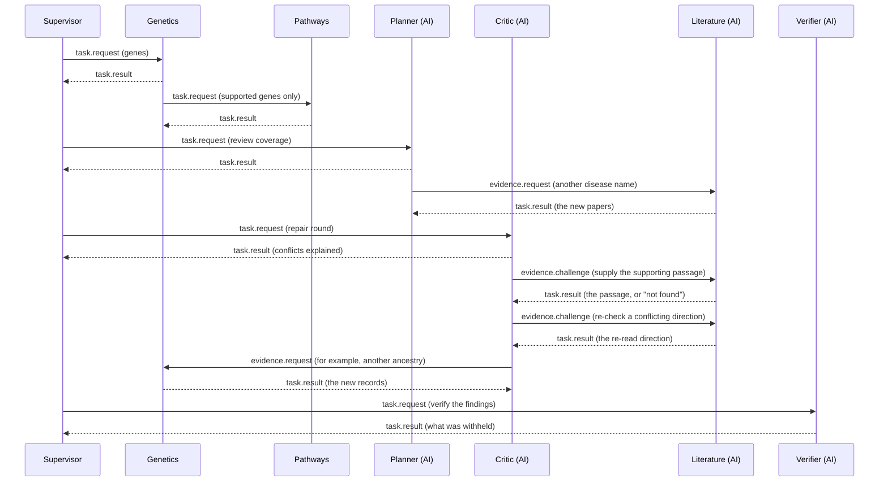

# How the team talks: messages, router and limits

The short version is in the [README](../README.md#communication-between-team-members). The roles themselves are described in [architecture.md](architecture.md#the-roles-in-detail).

Team members never call each other directly. A role returns messages, and the dispatcher hands every one to a **router** that checks it before delivery. This is BioNexus's own internal protocol, not the external Agent2Agent standard.

A role replies to the message it was given as soon as it has handled it, so each reply comes before the requests that role sends in the same turn. The order above is the order recorded in a real run.

**Who may message whom.** The router's allowlist, and what is actually sent today:

| From | May message | Sent today |
| --- | --- | --- |
| Supervisor | Every other role | `task.request`, to start each step |
| Genetics | Pathways | `task.request`, for genes with genetic support |
| Planner | The four specialists | `evidence.request`, to genetics, literature or clinical |
| Critic | The four specialists | `evidence.challenge` to literature; `evidence.request` to genetics, literature or clinical |
| Any role | Whoever asked it | `task.result`, as the reply |

**The envelope.** Every message has the same typed shape: `message_id`, `correlation_id` (the whole conversation), `parent_id` (the message it answers), `run_id`, `sender`, `recipient`, `type`, `payload`, `evidence_ids`, `depth` and `idempotency_key`. The ids, lineage and depth are set by one builder (`messaging/envelope.py`), never by an agent. There are five types: `task.request`, `task.result`, `evidence.challenge`, `evidence.request` and `task.failed`. The router accepts `task.failed` as a reply, but no agent sends it today: a failing step ends the run honestly instead (incomplete or failed).

**What a request may carry.** An `evidence.request` asks a specialist to search again with one hint: another name for the disease, an alias for a gene, or a short qualifier. A hint comes from a model, so it is checked before use (`contracts/hints.py`): 2 to 60 characters of letters, digits and a little punctuation, and never a double quote, so a hint cannot break out of the quoted phrase it is placed in. Europe PMC and ClinicalTrials.gov use any kind of hint to widen their query. GWAS uses a disease name or a gene alias and ignores a qualifier. The other sources ignore hints. The specialist answers with a search, so a request costs no model call, and only evidence the run does not already have is added.

**What the router enforces** (`messaging/router.py`):

| Rule | Detail |
| --- | --- |
| Allowlist | Supervisor may message every other role. Genetics may message pathways. The critic and the planner may message the four specialists. Anything else is rejected. |
| Replies | A `task.result` or `task.failed` is accepted only as an answer to a message that was addressed to the sender. |
| Depth cap | A chain of handoffs may be at most 3 deep. |
| Volume cap | At most 60 messages per run. The planner and the critic check the room left before sending and keep some in reserve for the verifier, so the cap is not expected to end a run. |
| No duplicates | A message with the same idempotency key (sender, recipient, type and payload) is dropped, so a retry never repeats work. |

The allowlist is wider than what runs today. In practice the routes used are supervisor to the three specialists, the planner, the critic and the verifier; genetics to pathways; the planner and the critic to genetics, literature and clinical; and the critic to literature.

**What is recorded.** Every accepted message is stored with the run, and each handoff appears in the live activity feed and the run's handoffs table (from, to, type, and for a challenge what it asked for, or for a request what to search for), so a reviewer can see who asked whom and why. Team members share no hidden memory: the only shared state is the run record, and evidence enters a model prompt only inside a delimited data block, never as instructions.
