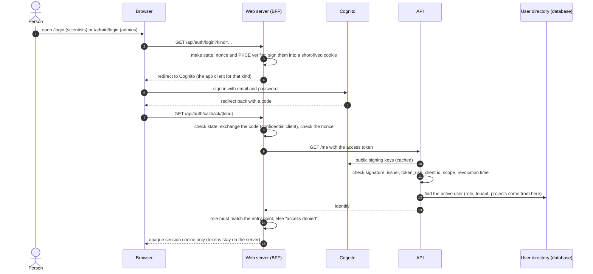
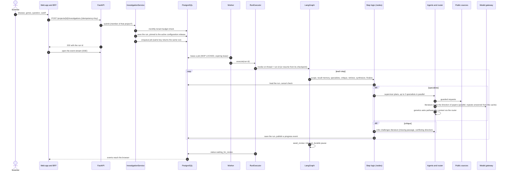
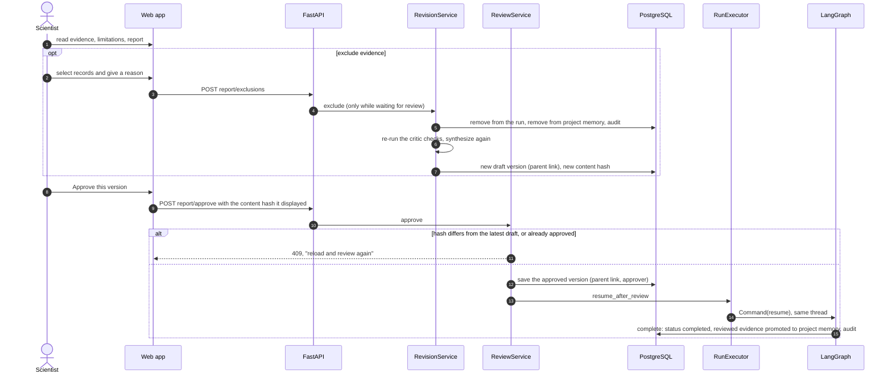
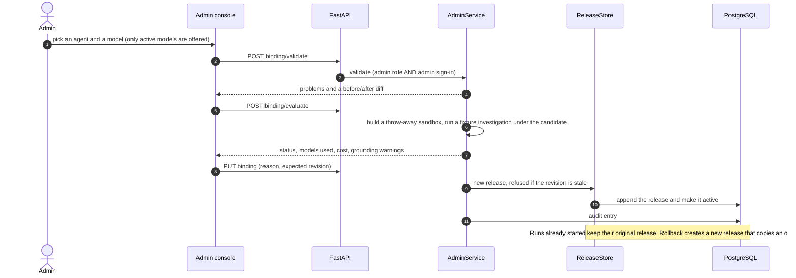

# How BioNexus works

The detail behind the [README](../README.md): the possible outcomes of a run, the main sequences, and which
code does each step. File names are relative to `services/api/bionexus/`. See also
[`services/api/README.md`](../services/api/README.md) and [`apps/web/README.md`](../apps/web/README.md).

## How an investigation can end

| Outcome | When | Shown to the user as |
| --- | --- | --- |
| `waiting_for_review` | The draft report is built and the graph is paused at the review step | "Needs your review" |
| `completed` | A scientist approved an exact report version | "Approved" |
| `incomplete` | A source was unavailable after two retries, no eligible evidence was found, the model budget or call limit was reached, models were stopped by an admin, or no approved model could answer | "Incomplete: partial results shown, nothing invented" |
| `failed` | An unexpected error | "Failed" with the error class and message |
| `cancelled` | The scientist cancelled; partial results are kept | "Cancelled" |

Incomplete and failed runs keep their LangGraph checkpoint at the failing step. They end honestly, never with an invented finding.

## Sequences

### Sign-in (two entry points, one user pool)

Roles live in the BioNexus database, not in token claims. An administrator signing in through the scientist client, or a scientist through the admin client, is refused by the server, not by hidden menus. Local development replaces Cognito with random dev tokens from your own `.env`, and refuses to start in production.

### Investigation path (scientist starts a run)

### Review and approval

### The journey of one investigation

An investigation turns a question into a **reviewed draft**. The scientist, not the system, decides what is accepted. The whole run is a LangGraph thread keyed by the run id, so it can be resumed after a crash.

1. **The request arrives.** From the web app or the API, after a project-membership check. The request must name 1 to 5 genes (letters, digits and hyphens, 2 to 15 characters), a disease and a question. The run is saved first, pinned to the active configuration release, and a job is enqueued with an idempotency key, so a double click creates one run.
2. **A worker picks it up.** It leases the job (`SKIP LOCKED`, five-minute lease, at most three attempts). If the worker dies, the lease expires and another worker resumes the same thread from its last checkpoint without starting a second investigation.
3. **Scope.** A cheap check that the request is complete.
4. **Recall reviewed memory.** Evidence this project's scientists already **approved**, for the same genes, still licensed and still before the cutoff, is added to the run. Unreviewed work is never reused, and a remembered conclusion is never counted as a new independent finding.
5. **Specialists, in parallel (2 at a time).** The supervisor plans fixed tasks for genetics, literature and clinical. Each specialist queries its own sources, then the **eligibility gate** keeps out anything unlicensed, dated after your cutoff or excluded in review, and records why. Genetics then asks the pathways agent for context, but only for genes with genetic support, through the router. If no eligible evidence exists at all, the run ends as `incomplete: no evidence found`. A transient source failure is retried (two retries); a persistent one ends the run as `incomplete`.
6. **Critique, up to two rounds.** A pure function finds three kinds of issue: a record with no supporting passage, a gene with both supporting and opposing studies, and a gene resting on one study family. The critic can act on two of them, and only through the literature agent. For a missing passage from Europe PMC it asks the literature agent to fetch the passage, or to say it cannot. For a gene with a conflict, it asks the literature agent for a **second look** at each direction a model assigned: the agent re-reads the **full** passage (up to 1,500 characters, where the first read saw 300), returns the direction it now finds (supports, opposes or unknown), and the record is relabelled "direction re-checked on the full passage (unreviewed)". At most 3 second looks are sent per round, each record at most once, and none are sent when the run is close to its 40-message cap. Directions that came straight from a database (Open Targets, GWAS) are not re-read, and a gene resting on one study family cannot be repaired, so both stay listed. Each challenge is sent once. Issues still open after the last round are listed in the report.
7. **Retrieve and rank.** Accepted evidence is indexed (full text plus vectors) and ranked for your question by fusing the two rankings with Reciprocal Rank Fusion. A small evidence graph is expanded at most two hops and 100 edges, only over approved relation types, with tenant and cutoff filters applied in SQL. Connectivity is context, not evidence of mechanism.
8. **Synthesize.** Claims are written per gene from at most 40 retained, ranked, accepted records, and each claim cites its record ids. A short narrative comes from the configured model. If the narrative contains blocked language (for example "causes", "cures", "should take"), it is replaced by the plain claim list.
9. **Finalize.** The draft report (Markdown) and its manifest are built, hashed, and saved. Saving the draft twice returns the first, so a retried step cannot create a second report.
10. **Pause for review.** The graph interrupts and the status becomes `waiting_for_review`. See the approval diagram for what happens next.

**Example numbers.** In one live run on 24 October 2026 (COVID-19, ACE2 and TMPRSS2, about 20 seconds), BioNexus collected 44 records. They were 39 distinct study families once repeats were merged, nine more records were set aside for licence reasons, and 8 findings pointed to an association. They illustrate the mechanics; live results change with the databases.

**Spending is capped before each call.** Every model call reserves its worst-case cost first, then settles to the actual cost. Defaults: US$10 hard limit and US$5 warning per investigation, 40 calls, and a monthly cap per organisation (US$200). All are settings that apply to the next submission.

**Which code does each step**

| Step | Class or function | File |
| --- | --- | --- |
| 1 Request | `submit()` route, `InvestigationService.submit()` | `api/run_routes.py`, `application/services.py` |
| 2 Worker | `Worker.run_pending()`, `RunExecutor.execute()` | `jobs/worker.py`, `workflow/runner.py` |
| Graph shape | `InvestigationGraph.build()` | `workflow/graph.py` |
| 3 to 4 Scope, memory | `InvestigationNodes.scope()`, `.recall_memory()` | `workflow/nodes.py`, `storage/ports.py` |
| 5 Specialists | `Dispatcher.run_parallel()`, `SpecialistAgent.assess()`, `GeneticsAgent.follow_ups()` | `workflow/dispatcher.py`, `agents/base.py`, `agents/genetics.py` |
| Router | `MessageRouter.accept()` | `messaging/router.py` |
| Eligibility | `partition_eligible()` | `evidence/eligibility.py` |
| Sources | `GuardedHttp`, the six `*Source` classes | `sources/http.py`, `sources/live/` (one module per source) |
| 6 Critique | `find_issues()`, `CriticAgent.handle()` | `agents/critic.py` |
| 7 Retrieve | `RetrievalService.search()` and `.expand()`, `fuse()` | `retrieval/service.py`, `retrieval/fusion.py` |
| 8 Synthesize | `SynthesizerAgent.write()`, `build_matrix()` | `agents/synthesizer.py`, `evidence/matrix.py` |
| 9 Report | `ReportBuilder.build_draft()` | `reporting/builder.py` |
| 10 Review | `await_review` node, `ReviewService.approve()`, `RevisionService` | `workflow/graph.py`, `reporting/review.py`, `reporting/revision.py` |
| Models | `ModelGateway.complete()`, `LangChainClient` | `llm/gateway.py`, `llm/langchain_client.py` |
| Budget | `Budget.reserve()` and `.settle()` | `workflow/budget.py` |

**What the checks do not cover.** The critic and the eligibility gate catch missing support, duplication, licence and date problems, and flagged contradictions. They do not read the science. A stance that comes from a model (for literature) is labelled "extracted by model (unreviewed)", and the direction of a finding can still be wrong. Counting independent studies reduces repetition, but does not make evidence strong. Only a scientist's review does that.

### Admin: change which model an agent uses

